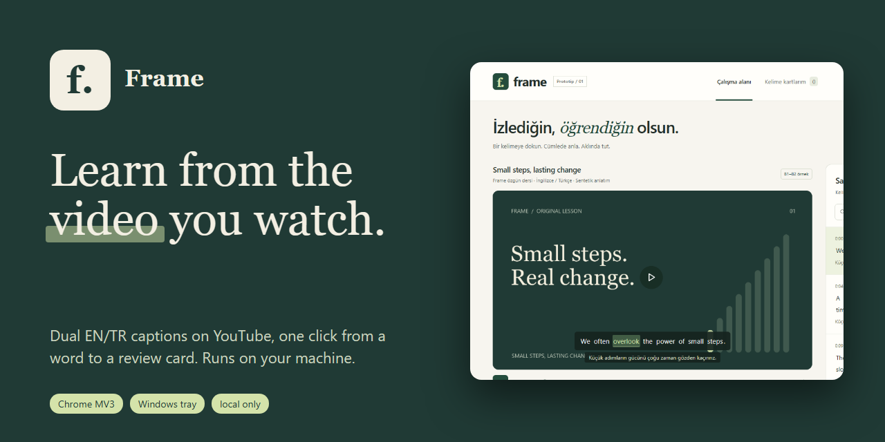
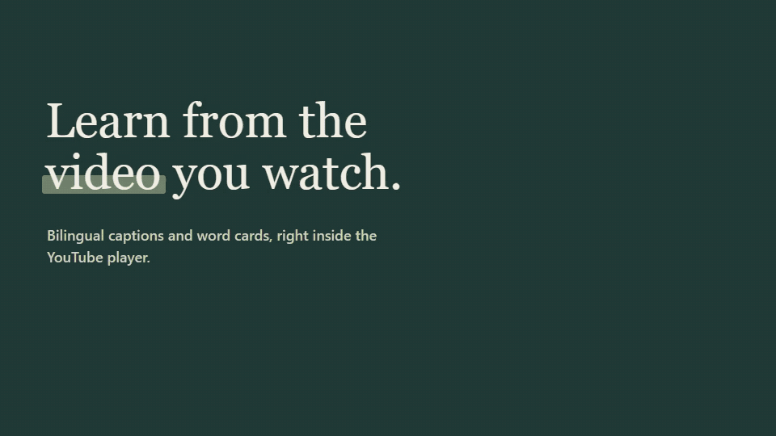
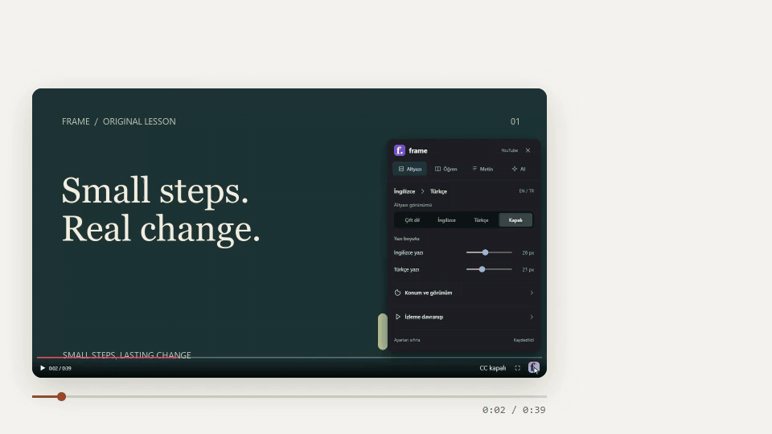
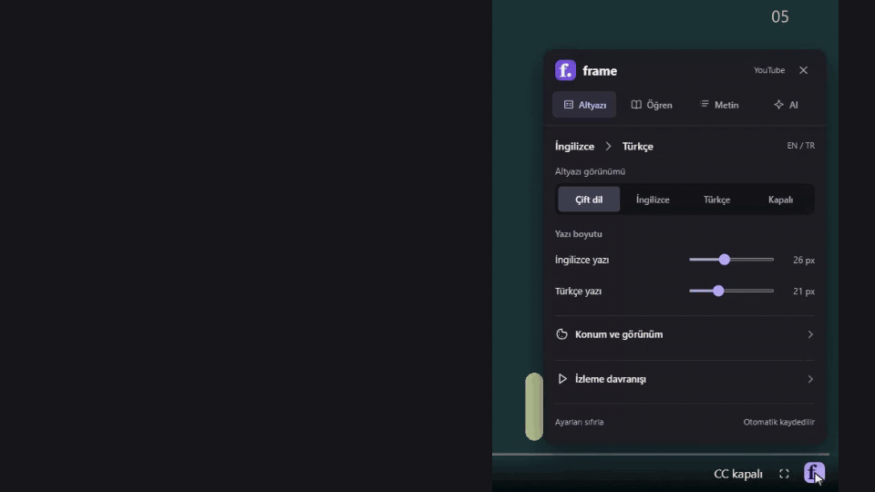
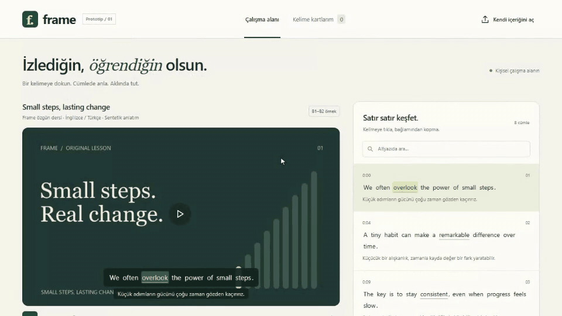
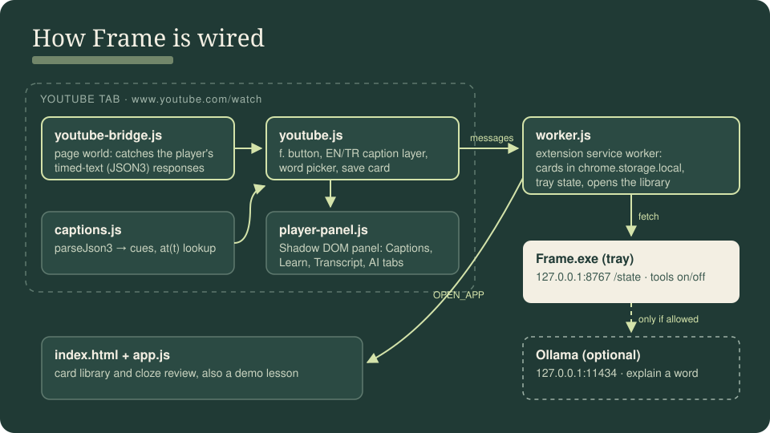
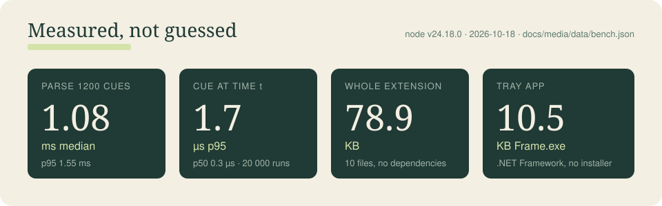

<p align="center"></p>

<p align="center"><b>English</b> · <a href="README.tr.md">Türkçe</a></p>

# Frame

Frame puts English and Turkish captions on any YouTube video and turns a tapped word into a review card. A small Windows tray app switches it on and off. Nothing leaves your machine except the caption requests YouTube already makes.

<p align="center"></p>

## What it does

**Dual captions, even with CC off.** Frame reads the player's own timed text and shows EN and TR lines in its own layer. Seek and the lines follow.



**Four tabs in one panel.** The f. button in the player bar opens Captions, Learn, Transcript and AI. It stays attached in full screen.



**Word to card.** Tap a word in the sentence: the video pauses, the sentence can loop, and the word is saved with its timestamp. The library brings you back to that second.



## How it fits together



## Numbers



Measured with `node bench/frame-bench.cjs` on 2026-10-18 (Node v24.18.0): 1,200 caption cues, 20,000 lookups. Raw data: [`docs/media/data/bench.json`](docs/media/data/bench.json).

## Quick start

1. Build and start the tray app: `powershell -File build-desktop.ps1`, then run `Frame.exe`. It sits in the system tray, no console.
2. In Chrome open `chrome://extensions`, turn on developer mode, choose **Load unpacked** and select this folder.
3. Refresh an open `youtube.com/watch` tab. The **f.** button appears at the bottom right of the player.

Opening `index.html` directly runs a built-in 40 second demo lesson without the extension.

## Permissions and data

- `storage`, page match only on `https://www.youtube.com/*`, and `http://127.0.0.1:8767/*` to read tray state.
- Ollama on `127.0.0.1:11434` is optional and asked for only from settings.
- No access to all sites, history, cookies or microphone. Cards live in `chrome.storage.local`.

## Limits

- YouTube watch pages only. Shorts and other sites are not supported yet.
- Caption access depends on YouTube's in-page data and JSON3 responses, not a stable public API.
- AI explanations need a local model. Without one, Frame shows no fake answer.
- The tray app is an unsigned dev build. No installer or auto start yet.

## Checks

```bash
node selfcheck.cjs
node captions-check.cjs
node preferences-check.cjs
node worker-check.cjs
```

`worker-check.cjs` needs the tray app running. Detailed test notes: [QA.md](QA.md), development notes: [docs/NOTES.md](docs/NOTES.md).

## License

[MIT](LICENSE).
